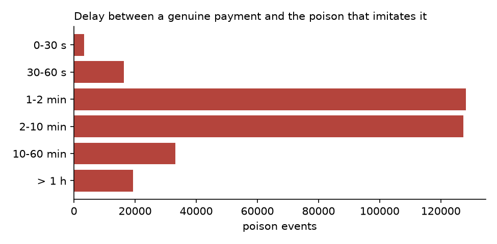
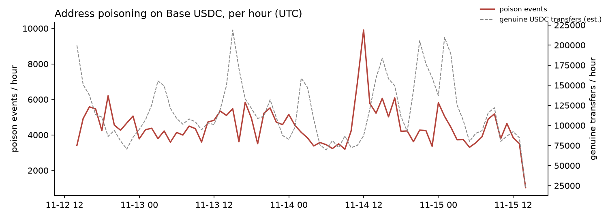

<div dir="rtl">

# הרעלת כתובות על USDC ברשת Base: חקירה של 72 שעות על נתוני בלוקצ'יין

[English](README.md) | **עברית**

**חלון הזמן:** הבלוקים 56,511,333 עד 57,807,333 ברשת Base הראשית, מ-12.11.2026 בשעה 14:10 ועד 15.11.2026 בשעה 14:10 (UTC).

**נתונים:** כל אירועי ה-`Transfer` של חוזה ה-USDC בחלון, 11,670,478 העברות, שנמשכו מ-RPC ציבורי. לא נעשה שימוש בתיוגים של צד שלישי.

## תקציר

| מדד | תוצאה |
|---|---|
| אירועי הרעלה שזוהו | **327,930** |
| קורבנות שהותקפו | **178,360** כתובות |
| כתובות מתחזות | **80,646** |
| עסקאות הרעלה | 35,153 |
| נתח של מפעיל אחד | **84.4%** מהאירועים, דרך חוזה batch אחד |
| הפסד USDC מאומת בתוך החלון | **תשלום אחד, 298 USDC** (נבדק על השרשרת) |

הרעלת כתובות ברשת Base פועלת בהיקף תעשייתי, ומפעיל אחד אחראי לרובה.

המתקפה זולה ופועלת כמעט ללא הפסקה, בקצב של כ-4,500 אירועים בשעה. מעט מאוד קורבנות נפלו בה במהלך שלושת הימים. הפסדים מגיעים בדרך כלל זמן רב אחרי ההרעלה, ולכן החלון הזה נותן **חסם תחתון** להפסדים ולא הערכה שלהם.

## איך המתקפה עובדת

1. הקורבן משלם לצד אמיתי `R`.
2. התוקף מייצר כתובת `L` שארבעת התווים הראשונים וארבעת האחרונים שלה זהים לאלה של `R`. הסיכוי שזה יקרה במקרה הוא 1 ל-16⁸ לכל זוג כתובות.
3. התוקף גורם ל-`L` להופיע בהיסטוריה של הקורבן, באחת משתי דרכים:
   - **זיוף בסכום 0:** קריאה ל-`transferFrom(victim → L, 0)`. סכום 0 לא דורש הרשאה, כך שכל אחד יכול לייצר אותה, ונראה כאילו הקורבן *שלח* כסף ל-`L`.
   - **אבק מהמתחזה:** `L` שולחת לקורבן סכום אמיתי זעיר.
4. בפעם הבאה הקורבן מעתיק את הכתובת ה"אחרונה" מהארנק או מסייר הבלוקים, ומשלם ל-`L`.

## ממצאים

### 1. מפעיל אחד מריץ את רוב ההרעלה

| ארנק משלם הגז | חוזה שנקרא | עסקאות | אירועים | נתח | קורבנות |
|---|---|---|---|---|---|
| `0x3959e496…f1f6` | `0xc3236716…5032` (סלקטור `0x12514bba`) | 8,054 | 276,623 | **84.4%** | 176,040 |
| `0xdf97d92d…b89d` | `0xf39fdf81…2797` | 2,355 | 14,594 | 4.5% | 6,218 |
| `0x6f92c759…3187` | `0x75161fd5…eb96` | 1,210 | 7,681 | 2.3% | 3,038 |
| `0x13203ab0…8931` | `0x6c05874f…0f61` | 1,249 | 4,940 | 1.5% | 3,004 |

- **ארנק אחד, חוזה batch אחד.** המפעיל המוביל קורא לחוזה batch יחיד מארנק יחיד. החוזה מפיק בממוצע כ-34 זיופים בסכום 0 בכל עסקה.
- **היקף המפעיל המוביל.** הוא השתמש ב-72,179 כתובות מתחזות שונות.
- **הדרג השני.** ארבעת המפעילים הבאים משתמשים כל אחד בחוזה batch משלו.
- **שולחי אבק ישירים.** עוד 522 ארנקים קוראים ישירות לחוזה ה-USDC. אלה כתובות מתחזות ששולחות אבק בעצמן.
- **הרשימה המלאה.** ראו [reports/operators.csv](reports/operators.csv) ו-[reports/contracts.csv](reports/contracts.csv).

### 2. זיופים בסכום 0 שולטים

| שיטה | אירועים | קורבנות |
|---|---|---|
| zero_value_spoof (זיוף בסכום 0) | 279,484 (85.2%) | 176,094 |
| dust_from_lookalike (אבק מהמתחזה) | 48,445 (14.8%) | 21,332 |

זיוף בסכום 0 עולה לתוקף רק את הגז, והגז ב-Base זול.

### 3. ההרעלה מגיעה דקות ספורות אחרי התשלום האמיתי



| זמן מאז ההעברה האמיתית | אירועים |
|---|---|
| 0–30 שניות | 3,402 |
| 30–60 שניות | 16,252 |
| 1–2 דקות | 128,226 |
| 2–10 דקות | 127,445 |
| 10–60 דקות | 33,209 |
| יותר משעה | 19,396 |

- **רוב ההרעלה מגיעה תוך 10 דקות.** 78% מהאירועים מגיעים 1 עד 10 דקות אחרי ההעברה האמיתית של הקורבן.
- **המתקפה אוטומטית.** המפעילים עוקבים אחרי ה-mempool או אחרי בלוקים חדשים, ומגיבים בזמן שהקורבן עדיין פעיל.

### 4. כתובות פופולריות מזויפות בהיקף גדול

- **מתחזה אחת, 55,547 קורבנות.** הכתובת `0x786aedd0…2fa8` מתחזה ל-`0x786abf52…2fa8`, ושימשה נגד 55,547 קורבנות שונים ב-72 שעות.
- **המטרה היא כתובת מרכזית.** הכתובת האמיתית היא כנראה כתובת עם תעבורה גבוהה, והתוקף מרעיל את כל מי שמשלם לה.
- **דפוס מימון.** מממן אחד, `0x0370fc95…729f`, שלח USDC ל-194 מהמתחזות ששולחות אבק. כדאי להמשיך ולעקוב אחרי הדפוס הזה.

### 5. איכות ההתאמה

| התאמה בהתחלה + בסוף | אירועים |
|---|---|
| 4 + 4 | 289,544 (88.3%) |
| 4 + 5 או 5 + 4 | 33,074 |
| 6 תווים או יותר באחד הצדדים | כ-4,000 |

- **התוקפים עושים את המינימום.** כמעט הכול הוא התאמה של 4 + 4, בדיוק מה שרוב הארנקים מציגים (`0xabcd…9876`).
- **התאמות מקריות זניחות.** בכל החלון צפויה בערך התאמה מקרית אחת בלבד, מול 327,930 אירועים שזוהו.

### 6. ההפסד המאומת

- **מי:** הקורבן `0x34a08f7c…8bd5`.
- **התשלום:** 298 USDC למתחזה `0x0742fdb7…d158` בעסקה [`0x732fdc7b…7434`](https://basescan.org/tx/0x732fdc7b313a0bacc29b63ec8a68bd2105d5bfdc1d45b2fbd7fa9d4ff2c77434). הסטטוס של העסקה הוא 1 (הצליחה), והקורבן חתם עליה בעצמו.

ציר הזמן (לפי בלוקים ב-Base):

| בלוק | אירוע |
|---|---|
| 57,515,112 | הקורבן מקבל 307 USDC מ-`0x4c2c0f0b…` (משלם קבוע) |
| 57,522,021 | הקורבן משלם **977 USDC** לכתובת האמיתית `0x07423f37…d158` |
| 57,522,539 | **הרעלה:** זיוף בסכום 0 מהקורבן אל `0x0742fdb7…d158`, שנשלח על ידי המפעיל המוביל (כ-1.7 דקות אחרי התשלום) |
| 57,530,349 | זיוף שני, אותה מתחזה ואותו מפעיל |
| 57,568,193 | הקורבן מקבל 298 USDC מאותו משלם קבוע |
| 57,583,093 | **הקורבן משלם 298 USDC למתחזה** (כ-3.4 שעות אחרי ההרעלה הראשונה) |

- **דוגמה קלאסית.** הקורבן מעביר בכל פעם את הכסף שנכנס לאותו יעד, ובפעם האחת שהעתיק את הכתובת מההיסטוריה, הוא העתיק את המזויפת.
- **ההרעלה עוברת הלאה.** בתוך החלון, הנמען האמיתי `0x07423f37…` מעביר את הכסף הלאה, ומיד מורעל בעצמו על ידי `0x6fa54e03…`, מתחזה של הצד שהוא משלם לו.

## שיטה

הקוד נמצא ב-[poison/](poison/), השאילתות ב-[sql/analysis.sql](sql/analysis.sql), והבדיקות ב-[tests/](tests/).

1. **איסוף.** [`collect.py`](poison/collect.py) מריץ `eth_getLogs` על חוזה ה-USDC ושומר את התוצאות ב-SQLite. הוא שומר כל כתובת פעם אחת, משנה את גודל טווח הבלוקים לפי הצורך (כדי לא לעבור את מגבלת 20,000 התוצאות של ה-RPC), ויכול להמשיך מאיפה שעצר.
2. **זיהוי.** ב-[`detect.py`](poison/detect.py), *מועמד* הוא העברה של פחות מ-0.1 USDC. מועמד נחשב אירוע הרעלה כאשר:
   - צד אחד הוא הקורבן, והצד השני `L` זהה לפחות ב-4 התווים הראשונים ולפחות ב-4 האחרונים ל**צד אמיתי** `R` של הקורבן;
   - "אמיתי" פירושו העברה של לפחות 1 USDC, לכל כיוון, **לפני** המועמד;
   - `L` עצמה **לא** הייתה צד אמיתי של הקורבן לפני האירוע (כלל ה"זר").
3. **הפסדים.** הפסד הוא העברה של לפחות 1 USDC מהקורבן ל-`L`, **אחרי** אירוע ההרעלה הראשון של אותו קורבן מאותה `L`.
4. **ייחוס.** [`campaigns.py`](poison/campaigns.py) שולף כל עסקת הרעלה עם `eth_getTransactionByHash`, כדי לדעת מי שילם את הגז ולאיזה חוזה נקרא. המידע הזה לא מופיע ב-`Transfer`. הסקריפט גם מוצא מי מימן את המתחזות ששולחות אבק.
5. **דוח.** [`report.py`](poison/report.py) מריץ את השאילתות, שומר את התוצאות ב-[reports/](reports/) ומצייר את הגרפים.

### תוצאה שגויה שנתפסה במהלך הניתוח

- **המספר השגוי.** הריצה הראשונה דיווחה על "הפסד" יחיד של **$15.88M**.
- **מה קרה בפועל.** בדיקה ידנית חשפה היפוך תפקידים:
  - כתובת מתחזה של תוקף שלחה לקורבן *בדיוק* 0.01 USDC;
  - הסף הישן החשיב 0.01 USDC כהעברה "אמיתית", ולכן התוקף הפך ל"צד האמיתי";
  - השותף העסקי האמיתי של הקורבן, שעבד איתו לאורך זמן, סומן כ"מתחזה";
  - התשלומים הרגילים לשותף נספרו כהפסדים.
- **התיקונים:**
  - הסף להעברה אמיתית הועלה ל-1 USDC;
  - הסף למועמד הוריד לפחות מ-0.1 USDC;
  - נוסף כלל ה"זר";
  - נוספה עמודה שמראה אם המתחזה החזירה כסף לקורבן, כך שכל הפסד נבדק ידנית.
- **בדיקות.** בדיקות רגרסיה לשני המקרים נמצאות ב-[tests/test_detect.py](tests/test_detect.py).
- **מה התיקון שינה.** מספר ההפסד ירד מ-$15.88M ל-$298. מספרי הזיהוי כמעט לא השתנו (328,153 אירועים לפני, 327,930 אחרי).

## מגבלות

- **נתון ההפסדים הוא חסם תחתון.** קורבנות משלמים לא פעם למתחזה ימים או שבועות אחרי ההרעלה. חלון של 72 שעות תופס רק הפסדים שקרו בתוכו, והרעלה שנשלחה קרוב לסוף החלון כמעט לא הספיקה לפעול.
- **רק USDC ברשת Base.** קורבן שהורעל כאן עלול להפסיד ETH או טוקנים אחרים, וההפסדים האלה לא נספרים.
- **פערים בזיהוי:**
  - מזהה העסקה נשמר רק להעברות של פחות מ-0.01 USDC, ולכן הייחוס לא מכסה אבק של 0.01 עד 0.1 USDC (ל-71 אירועים אין מזהה עסקה).
  - כתובות דומות שאינן זהות בדיוק בתחילתן ובסופן לא מזוהות.
- **ההיסטוריה מתחילה בתחילת החלון.** צד אמיתי שהקורבן עבד איתו רק לפני החלון לא נראה. לכן כלל ה"זר" מחמיץ מתחזות ששולם להן לפני החלון, ומפוספסת חלק מההרעלה של קשרים ישנים.
- **קצוות החלון חלקיים.** השעה הראשונה והאחרונה בגרף השעתי אינן מלאות.
- **תמונת מצב של RPC ציבורי.** התוצאות משקפות את מה שה-RPC החזיר בזמן האיסוף.



## הרצה מחדש

</div>

```bash
python -m venv .venv && .venv/Scripts/pip install -r requirements.txt
python -m poison.collect --hours 72      # writes ~/poisoning_data/base_usdc.db (about 1 GB, not in git)
python -m poison.detect
python -m poison.campaigns
python -m poison.report
python -m pytest
```
