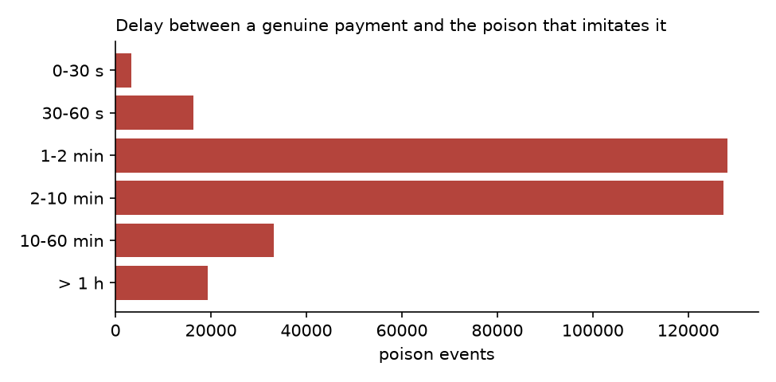
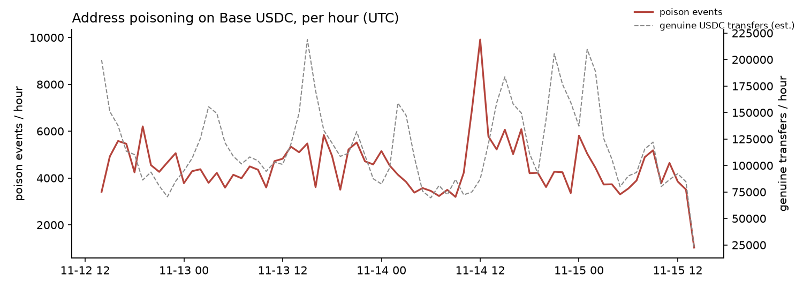

# Address poisoning on Base USDC: a 72-hour on-chain investigation

**English** | [עברית](README.he.md)

**Window:** Base mainnet blocks 56,511,333 to 57,807,333, 2026-11-12 14:10 to 2026-11-15 14:10 UTC.
**Data:** every USDC `Transfer` log in the window, 11,670,478 transfers, pulled from a public RPC. No third-party labels were used.

## Summary

| | |
|---|---|
| Poison events detected | **327,930** |
| Victims targeted | **178,360** addresses |
| Lookalike addresses used | **80,646** |
| Poisoning transactions | 35,153 |
| Share from one operator | **84.4%** of events, through one batch contract |
| Confirmed USDC lost inside the window | **1 payment, 298 USDC** (verified on-chain) |
| New losses in the ~20 h after the window | **0** |

Address poisoning is industrial on Base. One operator sent most of it.

The attack is cheap and runs almost all the time: about 4,500 poison events per hour. Very few victims fell for it during these three days. Losses usually come later than poisoning, so this window gives a lower bound on losses, not an estimate of them.

## How the attack works

1. A victim pays a real counterparty `R`.
2. The attacker generates an address `L` whose first 4 and last 4 hex characters match `R`. The odds of that happening by chance are 1 in 16⁸ per pair.
3. The attacker makes `L` show up in the victim's history, in one of two ways:
   - **zero-value spoof**: a `transferFrom(victim → L, 0)`. An amount of 0 needs no allowance, so anyone can emit it, and the victim appears to have *sent* to `L`.
   - **dust from lookalike**: `L` sends the victim a tiny real amount.
4. Next time, the victim copies the "recent" address from a wallet or explorer and pays `L`.

## Findings

### 1. One operator runs most of the poisoning

| Gas-paying sender | Contract called | Txs | Events | Share | Victims |
|---|---|---|---|---|---|
| `0x3959e496…f1f6` | `0xc3236716…5032` (selector `0x12514bba`) | 8,054 | 276,623 | **84.4%** | 176,040 |
| `0xdf97d92d…b89d` | `0xf39fdf81…2797` | 2,355 | 14,594 | 4.5% | 6,218 |
| `0x6f92c759…3187` | `0x75161fd5…eb96` | 1,210 | 7,681 | 2.3% | 3,038 |
| `0x13203ab0…8931` | `0x6c05874f…0f61` | 1,249 | 4,940 | 1.5% | 3,004 |

- **One EOA, one batch contract.** The top operator calls a single batch contract from a single EOA. That contract emits about 34 zero-value spoofs per transaction.
- **Scale of the top operator.** It used 72,179 distinct lookalike addresses.
- **The second tier.** The next four operators each use their own batch contract.
- **Direct dust senders.** Another 522 wallets call USDC directly. These are lookalikes sending dust themselves.
- **Full list.** See [reports/operators.csv](reports/operators.csv) and [reports/contracts.csv](reports/contracts.csv).

### 2. Zero-value spoofs dominate

| Pattern | Events | Victims |
|---|---|---|
| zero_value_spoof | 279,484 (85.2%) | 176,094 |
| dust_from_lookalike | 48,445 (14.8%) | 21,332 |

Zero-value spoofs cost the attacker only gas, and Base gas is cheap.

### 3. Poison arrives within minutes of the real payment



| Delay after the genuine transfer | Events |
|---|---|
| 0–30 s | 3,402 |
| 30–60 s | 16,252 |
| 1–2 min | 128,226 |
| 2–10 min | 127,445 |
| 10–60 min | 33,209 |
| > 1 h | 19,396 |

- **Most poison comes within 10 minutes.** 78% of events arrive 1–10 minutes after the victim's genuine transfer.
- **The attack is automated.** Operators watch the mempool or new blocks and react within the same session the victim is active in.

### 4. Popular addresses are imitated at scale

- **One lookalike, 55,547 victims.** `0x786aedd0…2fa8` imitates `0x786abf52…2fa8` and was used against 55,547 different victims in 72 hours.
- **The target is a hub.** The real address is clearly a high-traffic hub, and the attacker poisons everyone who pays it.
- **Funding pattern.** One funder, `0x0370fc95…729f`, sent USDC to 194 of the dust-sending lookalikes. That is a funding pattern worth tracing further.

### 5. Match quality

| Prefix + suffix match | Events |
|---|---|
| 4 + 4 | 289,544 (88.3%) |
| 4 + 5 / 5 + 4 | 33,074 |
| 6 or more on either side | about 4,000 |

- **Attackers do the minimum.** Nearly everything is a 4 + 4 match, which is exactly what most wallet UIs show (`0xabcd…9876`).
- **Chance matches are negligible.** About 1.0 coincidental match is expected among all candidates in the window, against 327,930 detected events.

### 6. The confirmed loss

- **Who:** victim `0x34a08f7c…8bd5`.
- **The payment:** 298 USDC to lookalike `0x0742fdb7…d158` in tx [`0x732fdc7b…7434`](https://basescan.org/tx/0x732fdc7b313a0bacc29b63ec8a68bd2105d5bfdc1d45b2fbd7fa9d4ff2c77434). The receipt has status 1, and the victim signed the transfer directly.

Timeline (Base blocks):

| Block | Event |
|---|---|
| 57,515,112 | Victim receives 307 USDC from `0x4c2c0f0b…` (a recurring payer) |
| 57,522,021 | Victim pays the real address `0x07423f37…d158` **977 USDC** |
| 57,522,539 | **Poison:** zero-value spoof victim → `0x0742fdb7…d158`, sent by the top operator (about 1.7 min later) |
| 57,530,349 | Second spoof, same lookalike, same operator |
| 57,568,193 | Victim receives 298 USDC from the same recurring payer |
| 57,583,093 | **Victim pays 298 USDC to the lookalike** (about 3.4 h after the first poison) |

- **Clean pattern.** It is a textbook case: the victim forwards incoming funds to the same destination each time, and the one time they copied from history, they copied the fake.
- **The poison passes on.** Within the window, the real recipient `0x07423f37…` forwards the money and is then poisoned in turn by `0x6fa54e03…`, a lookalike of its own counterparty.

## Following the money (after the window)

### 7. Follow-up: about 20 more hours, no new losses

[`followup.py`](poison/followup.py) asked the node for every USDC transfer **into** any of the 80,646 lookalikes from the end of the window (block 57,807,334) to block 58,167,968 (16 Nov 2026, 10:12 UTC), about 20 hours. It queries 2,000 addresses per call and is resumable, so the follow-up can be extended later.

| Transfers into lookalikes | Count |
|---|---|
| Total | 28,939 |
| Zero-value spoofs (lookalikes reused) | 28,416 |
| Dust (above 0, under 1 USDC) | 523 |
| **Payments of 1 USDC or more (new losses)** | **0** |

- **Checked against the known loss.** Run over the block of the 298 USDC loss, the same scanner finds it, so the zero reflects the data and not a broken query.
- **Still a lower bound.** Twenty hours is short. The script can be rerun to extend the follow-up period.

### 8. The main operator went quiet

- **Last transaction.** The top operator's gas wallet `0x3959e496…f1f6` sent 1,883 more transactions after the window. Its last one was [`0xbc235803…9d81`](https://basescan.org/tx/0xbc235803690def39f18488fd60cb59ce49e5b926f593d915158b338e78529d81) in block 58,022,783 (16 Nov 2026, 02:08 UTC): one batch of 300 spoofs for a fee of 0.0000189 ETH. Its nonce has not moved since (366,591).
- **Not just one wallet.** In 1,000-block samples, zero-value USDC transfers across all of Base fell from 100 (block 57.9M) to 7–26 (blocks 58.0M–58.16M), and only 0–7 of those went into known lookalikes. The campaign as a whole paused.
- **Probably not out of gas.** The wallet still holds 0.0000429 ETH, enough for about two more batches at the last fee. Why it stopped is unknown (hypothesis: a pause or a move to new infrastructure).
- **Cost.** About 63 nano-ETH (0.000000063 ETH) per spoof at that fee. Poisoning tens of thousands of wallets an hour costs very little on Base.

### 9. The stolen 298 USDC has not moved

- **Still in place.** As of 16 Nov 2026 the lookalike `0x0742fdb7…d158` still holds the 298 USDC.
- **Never active.** It has never sent a transaction (nonce 0) and has no code.
- **What it suggests.** Attackers leave the stolen funds in place for now (hypothesis: they collect from many lookalikes later).

### 10. How dust-sending lookalikes are funded

1. **ETH in.** `0x0370fc95…729f` swapped **0.0364 ETH for 69.886 USDC** through a DEX router (`0x0729e2a4…97f7`, via the WETH/USDC pool) in [`0x34d867bf…270e`](https://basescan.org/tx/0x34d867bf87583fc1c3425bb3ce4f8d0e2fbd53a83224f8ef5af10e64a326270e).
2. **Fan-out.** It then sent **exactly 0.122 USDC to 567 addresses**, between blocks 57,085,898 and 57,100,363. No other address in the window sent that amount more than 20 times, so the amount works as a fingerprint.
3. **Use.** 194 of those addresses appear as lookalikes in this data. They sent 19,931 dust transfers to 9,687 victims, each lookalike paying its own gas.

**Confirmed with ETH transfer data** ([`trace.py`](poison/trace.py)): alongside the USDC, the funder sent **exactly 0.00014 ETH to the same 567 addresses**. Each lookalike received a fixed starter kit: gas money plus dust money. This accounts for the wallet's nonce of 1,135 (1 swap + 567 + 567).

> **First reading corrected.** The router sends tens of millions of USDC to thousands of addresses, and at first it looked like the funder had *withdrawn* from a service. The transaction itself showed the funder sent the ETH and swapped it. A router is not a custodian, so there is no account behind it to identify.

### 11. Where the ETH comes from

Native ETH transfers do not appear in event logs, so this step uses Alchemy's `alchemy_getAssetTransfers` ([`trace.py`](poison/trace.py), results in [reports/trace_sources.csv](reports/trace_sources.csv)).

**The funder.** Its first money was 0.119844 ETH on 13 Nov 2026 at 21:59 UTC. It arrived as an internal transfer from contract `0xa18968cc…3501`, through a call to `withdrawETH(address,uint256)` ([`0xf0bbd0f6…781c`](https://basescan.org/tx/0xf0bbd0f664c437d86b7f4a43f07c2ef87cb69566c28ea06109e919b065f7781c)). The call was sent by an automated wallet with 240,599 transactions, and the contract moved 1.8M USDC during the window. That is the shape of a withdrawal from a custodial service (hypothesis: the contract is not labelled). Three minutes later the funder swapped part of the ETH for USDC and started the fan-out.

**The top operator.** Its gas wallet has been active since 24 Nov 2025, about a year. It was refilled 99 times from 90 different sources, 2.796 ETH in total. The 15 largest sources supplied almost all of it:

| Source profile | Sources | ETH |
|---|---|---|
| EOA with nonce ≥ 400,000 (service-like) | 6 | 1.775 |
| Contract (internal transfer) | 4 | 0.718 |
| EOA with a low nonce | 5 | 0.303 |

- **The biggest single refill.** 0.643 ETH came from `0xf70da978…dbef`, an EOA with a nonce of 17.2M that sent 28.7M USDC in the 72-hour window. That is the profile of an exchange hot wallet (hypothesis, not a label).
- **Spread on purpose.** 90 sources for 99 refills is consistent with spreading funding across services so that no single account links to the operation (hypothesis).

**Why this matters.** In a real case, these withdrawals are the lead to follow. A custodial service knows which customer account made each withdrawal (KYC), and a request from law enforcement could name them. This analysis can point to the transactions, but not to the people.

## Live detector

The research above ran once, on 72 hours of past data. [`live.py`](poison/live.py) applies the same rules **to every new block as it arrives**, one transfer at a time and in chain order, and raises an alert for each new (victim, lookalike) pair and for each payment to a lookalike.

| Check | Result |
|---|---|
| **Same answers as the research.** The full 72 h window (11,670,478 transfers) run through the live logic | 327,930 poison events, 241,977 victim–lookalike pairs, 1 loss (298 USDC). **Identical** to the batch detector |
| **Speed** | about 7,300 transfers per second on a laptop. Base carries about 35 USDC transfers per second |
| **Time to alert on the live chain** | 4 seconds from block to alert (16 Nov 2026, block 58,607,803) |
| **Caught live poisoning from a cold start** | yes: one batch transaction poisoned 4 victims about 90 seconds after the detector started |

- **It remembers relationships.** Every transfer of 1 USDC or more is stored as a relationship. A poison alert needs a relationship from an *earlier* block, which is the same rule as the research.
- **Warm start.** A fresh detector knows no history, so it misses poisoning that imitates older counterparties. `--seed` loads the research window's relationships first. Relationships unused for 30 days are dropped (`--keep-days`).
- **Reorg safety.** It stays 10 blocks (~2 s) behind the head.

### Telegram alert bot

[`bot.py`](poison/bot.py) turns the detector's alerts into messages. A user sends the bot a wallet address and gets a message within seconds when that wallet is poisoned or pays a lookalike.

| Command | What happens |
|---|---|
| `/watch 0x…` | watch an address; the reply also lists lookalikes already planted in its history |
| ⚠️ poison alert | the real address, the fake one and the transaction, a few seconds after the poisoning |
| 🚨 loss alert | the amount sent to the lookalike, and what to do next |
| `/check 0x…` | before sending: was this address used to poison anyone? |
| `/unwatch`, `/list` | stop, and list watched addresses |

- **Privacy.** The bot stores only (chat id, watched address), locally, and alerts only the chat that watches an address. There is no public list of victims.
- **One alert per lookalike.** Repeats raise a counter, not a new message. A user who blocks the bot is removed.
- **Tested live.** `/check` on a lookalike caught minutes earlier answered: used to poison 11 wallets, all imitating one real address.

### Check page and dashboard

[`web.py`](poison/web.py) serves two local pages (`python -m poison.web`, then http://127.0.0.1:8787).

**Check before you send.** You paste the address you are about to pay, and optionally your own wallet. The answer is one of four:

| Verdict | When |
|---|---|
| 🚨 Do not send | a known lookalike, planted in your history, or already paid by a victim |
| ⚠️ Looks like an address you have paid | it shares the first and last 4 characters with one of your counterparties, but you never paid it. This catches a lookalike **before** it is seen in an attack |
| ✓ You have paid it before | your wallet already sent or received ≥ 1 USDC with this exact address |
| No record | none of the above; the page says this is not proof it is safe |

The page underlines every character that differs from the real address. It recognises the research window's 241,370 lookalike pairs plus everything the live detector finds.

**Dashboard.** It refreshes every 10 seconds and shows:
- the detector's status;
- poisoned wallets, lookalikes and payments to lookalikes;
- new pairs per 10 minutes (with a table view);
- the most imitated addresses and the busiest lookalikes;
- the precision results below.

It lists imitated addresses and lookalikes, never victims.

### How often is it wrong?

There is no labelled list of poisoners, so [`evaluate.py`](poison/evaluate.py) bounds precision from three sides on the 72-hour window:

| Check | Result |
|---|---|
| **Chance.** Random addresses that match a counterparty's first and last 4 characters | about 1 of 327,930 events expected |
| **Behaviour.** A lookalike exists to be copied, so it should do no real business. Flagged lookalikes with any ≥ 1 USDC transfer (other than a victim's loss) | **0 of 80,646** |
| **Control for that test.** The same test on 1,000 of the real addresses being imitated | 1,000 of 1,000 have real activity, so the test works |
| **Vanity addresses.** Events between low-entropy addresses (e.g. `0x…cccc`), which could match without an attack | 109 events, counted as uncertain |
| **Precision, lower bound** | **99.97%** of events |

- **Not measured: recall.** The detector misses poisoning that imitates relationships older than its memory, and near-miss lookalikes (for example 3 matching characters, or matching characters in the middle).
- **Short behaviour window.** The behaviour test sees only 72 hours of each address.

## Method

Code is in [poison/](poison/), queries in [sql/analysis.sql](sql/analysis.sql), and tests in [tests/](tests/).

1. **Collect.** [`collect.py`](poison/collect.py) runs `eth_getLogs` over the USDC contract and stores the logs in SQLite. It interns addresses, uses an adaptive block step (to stay under the RPC's 20,000-result cap), and can resume.
2. **Detect.** In [`detect.py`](poison/detect.py), a *candidate* is a transfer under 0.1 USDC. A candidate becomes a poison event when:
   - one side is the victim, and the other side `L` matches ≥ 4 leading and ≥ 4 trailing hex characters of a **genuine counterparty** `R` of the victim;
   - "genuine" means a transfer of at least 1 USDC, in either direction, **before** the candidate;
   - `L` itself is **not** a genuine counterparty of the victim before the event (the stranger rule).
3. **Losses.** A loss is a victim → `L` transfer of at least 1 USDC **after** that victim's first poison event from `L`.
4. **Attribution.** [`campaigns.py`](poison/campaigns.py) fetches each poisoning transaction with `eth_getTransactionByHash` to get the gas payer and the contract called, which a `Transfer` log does not show. It also lists who funded dust-sending lookalikes.
5. **Report.** [`report.py`](poison/report.py) runs the named queries into [reports/](reports/) and draws the charts.

### A false positive caught during the analysis

- **The bad number.** The first run reported a single "loss" of **$15.88M**.
- **What actually happened.** Manual review showed a role reversal:
  - an attacker's lookalike had sent the victim *exactly* 0.01 USDC;
  - the old threshold counted 0.01 USDC as "genuine", so the attacker became the "real counterparty";
  - the victim's real, long-running business partner was labelled the "lookalike";
  - the partner's normal payments were then counted as losses.
- **The fixes:**
  - raised the genuine threshold to 1 USDC;
  - lowered the candidate threshold to under 0.1 USDC;
  - added the stranger rule;
  - added a "lookalike paid the victim back" column, so every loss gets a manual check.
- **Tests.** Regression tests for both cases are in [tests/test_detect.py](tests/test_detect.py).
- **What the correction did.** The headline loss number fell from $15.88M to $298. The detection counts barely moved (328,153 events before, 327,930 after).

## Limitations

- **The loss figure is a lower bound.** Victims often pay a lookalike days or weeks after being poisoned. A 72-hour window catches only losses that happen inside it, and poison sent near the end has had almost no time to work.
- **USDC on Base only.** A victim poisoned here may lose ETH or other tokens, and those losses are not counted.
- **Some detection gaps:**
  - Transaction hashes are stored only for transfers under 0.01 USDC, so attribution misses dust between 0.01 and 0.1 USDC (71 events have no hash).
  - Approximate (similar-looking, non-exact) lookalikes are not detected.
- **Genuine history starts at the window.** A counterparty from before the window is invisible. The stranger rule therefore misses lookalikes that were paid before the window, and some poisoning of older relationships is missed.
- **The edges of the window are partial.** The first and last hours in the hourly chart are incomplete.
- **Snapshot of a public RPC.** Results reflect the logs the RPC returned at collection time.



## Reproduce

```bash
python -m venv .venv && .venv/Scripts/pip install -r requirements.txt
python -m poison.collect --hours 72      # writes ~/poisoning_data/base_usdc.db (about 1 GB, not in git)
python -m poison.detect
python -m poison.campaigns
python -m poison.report
python -m poison.followup     # payments into lookalikes after the window; rerun to extend
python -m poison.trace        # ETH funding sources; needs ALCHEMY_KEY=... in .env (git-ignored)
python -m poison.live --replay  # live logic on the research window; must match detect.py
python -m poison.live --seed    # optional warm start from the research window
python -m poison.live           # follow the chain head; Ctrl+C to stop, rerun to resume
python -m poison.bot            # Telegram alerts; needs TELEGRAM_BOT_TOKEN=... in .env
python -m poison.web            # check page and dashboard on http://127.0.0.1:8787
python -m poison.evaluate       # precision checks -> reports/evaluation.json
python -m pytest
```
